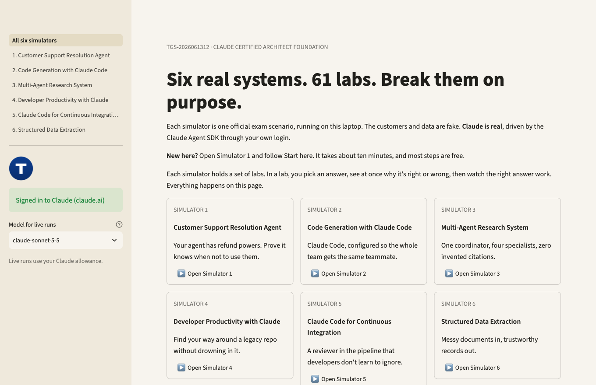

# Claude Certified Architect Foundation

Run six real agent systems on your own laptop, break them on purpose, and learn what the Claude Certified Architect exam actually tests.

| Course detail | Information |
|---|---|
| Course code | `TGS-2026061312` |
| Programme | WSQ |
| Duration | 2 days / 16 hours |
| Courseware release | Trainer deck v2.4, Lesson Plan v2.3, Learner Guide v2.3 |
| Registration | [View course details and register](https://www.tertiarycourses.com.sg/wsq-claude-certified-architect-foundation.html) |
| Funding | Up to 70% course fee funding for eligible learners and employers. Eligibility and current terms apply. |



## About the course

You learn architecture judgement for agentic systems: when a prompt is enough, when a rule must live in code, and how to prove a system stays useful when tools fail, context grows and confidence runs out. Each topic teaches a concept, then you test it straight away on a working simulator.

## Learning outcomes

By the end of the course, you will be able to:

- Design bounded agentic loops and multi-agent orchestration with explicit handoffs, state and stop conditions.
- Engineer reliable tool and MCP integrations with precise schemas, structured errors and least-privilege tool distribution.
- Configure Claude Code projects with scoped instructions, reusable skills, rules, plan mode and CI/CD workflows.
- Produce validated structured outputs using clear criteria, few-shot examples, batching and review loops.
- Manage context, uncertainty, provenance and human escalation in large, long-running AI systems.

## Topics covered

| Topic and exam domain | Weight |
|---|---:|
| Agentic Architecture & Orchestration | 27% |
| Tool Design & MCP Integration | 18% |
| Claude Code Configuration & Workflows | 20% |
| Prompt Engineering & Structured Output | 20% |
| Context Management & Reliability | 15% |

## Six simulators

Each simulator is one official exam scenario, written in Python on the [Claude Agent SDK](https://code.claude.com/docs/en/agent-sdk/overview) and run with [uv](https://docs.astral.sh/uv/). It runs on this laptop through your own Claude login, with no API key. The customers and data are fake. Claude is real.

1. **[Customer Support Resolution Agent](labs/simulators/simulator-1-customer-support/)**: Your agent has refund powers. Prove it knows when not to use them.
2. **[Code Generation with Claude Code](labs/simulators/simulator-2-code-generation/)**: Claude Code, configured so the whole team gets the same teammate.
3. **[Multi-Agent Research System](labs/simulators/simulator-3-multi-agent-research/)**: One coordinator, four specialists, zero invented citations.
4. **[Developer Productivity with Claude](labs/simulators/simulator-4-developer-productivity/)**: Find your way around a legacy repo without drowning in it.
5. **[Claude Code for Continuous Integration](labs/simulators/simulator-5-ci-cd/)**: A reviewer in the pipeline that developers don't learn to ignore.
6. **[Structured Data Extraction](labs/simulators/simulator-6-structured-extraction/)**: Messy documents in, trustworthy records out.

```bash
claude auth login      # first time only
cd labs
uv sync                # first time only
uv run serve.py        # opens http://localhost:8765, or the next free port
```

Each simulator page has **Start here** (the scenario in plain words, then steps to follow), **Play it live** (you act in the scenario and watch each step as it happens) and its **lab buttons**. Live runs use your Claude allowance. Show the saved run is free.

Every lab page has a built-in terminal, so you never need to open one. Prefer Claude Code? Open it in `labs` and type `/lab 9`.

Simulator 6 and the batch labs run the Message Batches workflow locally, so they show the steps but not the 50% discount or the 24-hour window.

## Labs

In a lab, you pick an answer, see at once why it is right or wrong, then watch the right answer work. Numbers follow the exam domains, so each simulator holds its own set. Lab 9 means the same thing on the slide, on the simulator page, in its PDF and in the Learner Guide. You run 33 of them in class.

Questions come from the SkillCertPro practice exam Part 1 (40 labs, third-party and unofficial, reconstructed from a video transcript, so treat them as practice material and never as real exam items), the official sample questions in the exam guide (7 labs) and the exam guide's task statements (14 labs).

### Topic 1: Agentic Architecture & Orchestration

| Lab | Task | Simulator | What you find out |
|---|---|---|---|
| 1 | 1.1 | 1 | [Watch one refund go round the loop](labs/topic-1-agentic-architecture/lab-01-watch-one-refund-go-round-the-loop.pdf) |
| 2 | 1.1 | 2 | [Claude re-asks because the tool_result never came back](labs/topic-1-agentic-architecture/lab-02-claude-re-asks-because-the-tool-result-never-cam.pdf) |
| 3 | 1.2 | 3 | [Every subagent succeeds, and the report still misses half the topic](labs/topic-1-agentic-architecture/lab-03-every-subagent-succeeds-and-the-report-still-mis.pdf) |
| 4 | 1.2 | 6 | [Same brief to every subagent, same findings four times](labs/topic-1-agentic-architecture/lab-04-same-brief-to-every-subagent-same-findings-four.pdf) |
| 5 | 1.3 | 2 | [A /parallel-review that can't fan out because Task isn't allowed](labs/topic-1-agentic-architecture/lab-05-a-parallel-review-that-can-t-fan-out-because-tas.pdf) |
| 6 | 1.3 | 5 | [Same reviewers, same findings, and the PR comment loses them all](labs/topic-1-agentic-architecture/lab-06-same-reviewers-same-findings-and-the-pr-comment.pdf) |
| 7 | 1.3 | 3 | [Polished report, weak citations: route information, not just tasks](labs/topic-1-agentic-architecture/lab-07-polished-report-weak-citations-route-information.pdf) |
| 8 | 1.3 | 3 | [Later subagents re-run searches the first ones already finished](labs/topic-1-agentic-architecture/lab-08-later-subagents-re-run-searches-the-first-ones-a.pdf) |
| 9 | 1.4 | 1 | [12% of cases skip get_customer: fix it with a gate, not a sentence](labs/topic-1-agentic-architecture/lab-09-12-of-cases-skip-get-customer-fix-it-with-a-gate.pdf) |
| 10 | 1.4 | 5 | [Approval must never post before the passing test artifact exists](labs/topic-1-agentic-architecture/lab-10-approval-must-never-post-before-the-passing-test.pdf) |
| 11 | 1.4 | 6 | [Claude guesses a field and submits without validating](labs/topic-1-agentic-architecture/lab-11-claude-guesses-a-field-and-submits-without-valid.pdf) |
| 12 | 1.5 | 1 | [The prompt forgot the $500 rule. The hook did not.](labs/topic-1-agentic-architecture/lab-12-the-prompt-forgot-the-500-rule-the-hook-did-not.pdf) |
| 13 | 1.5 | 2 | [Shrink noisy npm test output before Claude reads it](labs/topic-1-agentic-architecture/lab-13-shrink-noisy-npm-test-output-before-claude-reads.pdf) |
| 14 | 1.5 | 4 | [rm -rf meets a hook, not a polite request](labs/topic-1-agentic-architecture/lab-14-rm-rf-meets-a-hook-not-a-polite-request.pdf) |
| 15 | 1.6 | 6 | [60-page packets: section passes first, reconcile second](labs/topic-1-agentic-architecture/lab-15-60-page-packets-section-passes-first-reconcile-s.pdf) |
| 16 | 1.7 | 2 | [Two attempts, one analysis: fork the session, checkpoint the files](labs/topic-1-agentic-architecture/lab-16-two-attempts-one-analysis-fork-the-session-check.pdf) |
| 17 | 1.7 | 4 | [Resume, and say exactly which file changed](labs/topic-1-agentic-architecture/lab-17-resume-and-say-exactly-which-file-changed.pdf) |

### Topic 2: Tool Design & MCP Integration

| Lab | Task | Simulator | What you find out |
|---|---|---|---|
| 18 | 2.1 | 6 | [One analyze_document tool does three jobs badly](labs/topic-2-tool-design-and-mcp/lab-18-one-analyze-document-tool-does-three-jobs-badly.pdf) |
| 19 | 2.2 | 1 | [The refund failed. The customer was told it worked.](labs/topic-2-tool-design-and-mcp/lab-19-the-refund-failed-the-customer-was-told-it-worke.pdf) |
| 20 | 2.2 | 1 | [Retry the timeout once, then answer from the real record](labs/topic-2-tool-design-and-mcp/lab-20-retry-the-timeout-once-then-answer-from-the-real.pdf) |
| 21 | 2.3 | 5 | [Review and test generation fight over one Claude call](labs/topic-2-tool-design-and-mcp/lab-21-review-and-test-generation-fight-over-one-claude.pdf) |
| 22 | 2.3 | 3 | [Give synthesis one narrow tool, not the whole web](labs/topic-2-tool-design-and-mcp/lab-22-give-synthesis-one-narrow-tool-not-the-whole-web.pdf) |
| 23 | 2.4 | 2 | [Commit the server, never the token](labs/topic-2-tool-design-and-mcp/lab-23-commit-the-server-never-the-token.pdf) |
| 24 | 2.4 | 4 | [Read the catalogue before opening a single file](labs/topic-2-tool-design-and-mcp/lab-24-read-the-catalogue-before-opening-a-single-file.pdf) |
| 25 | 2.5 | 4 | [/find-callers needs Grep with a glob, not Bash](labs/topic-2-tool-design-and-mcp/lab-25-find-callers-needs-grep-with-a-glob-not-bash.pdf) |
| 26 | 2.5 | 4 | [Edit says the anchor isn't unique. Now what?](labs/topic-2-tool-design-and-mcp/lab-26-edit-says-the-anchor-isn-t-unique-now-what.pdf) |

### Topic 3: Claude Code Configuration & Workflows

| Lab | Task | Simulator | What you find out |
|---|---|---|---|
| 27 | 3.1 | 2 | [Which instructions actually reached Claude?](labs/topic-3-claude-code-configuration/lab-27-which-instructions-actually-reached-claude.pdf) |
| 28 | 3.2 | 2 | [A /review command the whole team gets through git](labs/topic-3-claude-code-configuration/lab-28-a-review-command-the-whole-team-gets-through-git.pdf) |
| 29 | 3.2 | 1 | [Keep a noisy case review out of your main session](labs/topic-3-claude-code-configuration/lab-29-keep-a-noisy-case-review-out-of-your-main-sessio.pdf) |
| 30 | 3.3 | 3 | [Testing rules for test files spread across every folder](labs/topic-3-claude-code-configuration/lab-30-testing-rules-for-test-files-spread-across-every.pdf) |
| 31 | 3.4 | 2 | [Replacing the auth layer: nobody agrees on the boundary, so plan](labs/topic-3-claude-code-configuration/lab-31-replacing-the-auth-layer-nobody-agrees-on-the-bo.pdf) |
| 32 | 3.4 | 2 | [Plan first, then approve into an editing mode](labs/topic-3-claude-code-configuration/lab-32-plan-first-then-approve-into-an-editing-mode.pdf) |
| 33 | 3.4 | 2 | [One guard clause doesn't need a plan](labs/topic-3-claude-code-configuration/lab-33-one-guard-clause-doesn-t-need-a-plan.pdf) |
| 34 | 3.5 | 5 | [Unknown requirements? Let Claude interview you first](labs/topic-3-claude-code-configuration/lab-34-unknown-requirements-let-claude-interview-you-fi.pdf) |
| 35 | 3.5 | 3 | [Two linked defects go in one detailed request](labs/topic-3-claude-code-configuration/lab-35-two-linked-defects-go-in-one-detailed-request.pdf) |
| 36 | 3.6 | 5 | [The nightly job hangs because nobody can press Enter](labs/topic-3-claude-code-configuration/lab-36-the-nightly-job-hangs-because-nobody-can-press-e.pdf) |
| 37 | 3.6 | 5 | [A shared slash command still needs -p in CI](labs/topic-3-claude-code-configuration/lab-37-a-shared-slash-command-still-needs-p-in-ci.pdf) |

### Topic 4: Prompt Engineering & Structured Output

| Lab | Task | Simulator | What you find out |
|---|---|---|---|
| 38 | 4.1 | 5 | ["Only high confidence" didn't quiet the reviewer](labs/topic-4-prompt-engineering/lab-38-only-high-confidence-didn-t-quiet-the-reviewer.pdf) |
| 39 | 4.1 | 3 | [Switch off the one noisy category, keep the accurate ones](labs/topic-4-prompt-engineering/lab-39-switch-off-the-one-noisy-category-keep-the-accur.pdf) |
| 40 | 4.2 | 2 | ["Clean this up" means three things: show which one you mean](labs/topic-4-prompt-engineering/lab-40-clean-this-up-means-three-things-show-which-one.pdf) |
| 41 | 4.3 | 3 | [Vague passages forced into a category they don't fit](labs/topic-4-prompt-engineering/lab-41-vague-passages-forced-into-a-category-they-don-t.pdf) |
| 42 | 4.3 | 6 | [Know your tool_choice options, and check what came back](labs/topic-4-prompt-engineering/lab-42-know-your-tool-choice-options-and-check-what-cam.pdf) |
| 43 | 4.4 | 1 | [Valid JSON, wrong refund: add business rules](labs/topic-4-prompt-engineering/lab-43-valid-json-wrong-refund-add-business-rules.pdf) |
| 44 | 4.4 | 6 | [Retry when the format is wrong, stop when the data is absent](labs/topic-4-prompt-engineering/lab-44-retry-when-the-format-is-wrong-stop-when-the-dat.pdf) |
| 45 | 4.5 | 1 | [Prove the template before 35,000 transcripts](labs/topic-4-prompt-engineering/lab-45-prove-the-template-before-35-000-transcripts.pdf) |
| 46 | 4.5 | 1 | [Client tools can't run inside a batch](labs/topic-4-prompt-engineering/lab-46-client-tools-can-t-run-inside-a-batch.pdf) |
| 47 | 4.5 | 6 | [Nightly job on Batches, upload flow stays synchronous](labs/topic-4-prompt-engineering/lab-47-nightly-job-on-batches-upload-flow-stays-synchro.pdf) |
| 48 | 4.6 | 3 | [The author reviewing its own draft misses its own errors](labs/topic-4-prompt-engineering/lab-48-the-author-reviewing-its-own-draft-misses-its-ow.pdf) |
| 49 | 4.6 | 3 | [Source-level passes first, integration second](labs/topic-4-prompt-engineering/lab-49-source-level-passes-first-integration-second.pdf) |
| 50 | 4.6 | 5 | [14 files, shallow comments: split the review](labs/topic-4-prompt-engineering/lab-50-14-files-shallow-comments-split-the-review.pdf) |

### Topic 5: Context Management & Reliability

| Lab | Task | Simulator | What you find out |
|---|---|---|---|
| 51 | 5.1 | 1 | [Refund amount jumped to the wrong order](labs/topic-5-context-and-reliability/lab-51-refund-amount-jumped-to-the-wrong-order.pdf) |
| 52 | 5.1 | 5 | [40-field tool results push the review to its limit](labs/topic-5-context-and-reliability/lab-52-40-field-tool-results-push-the-review-to-its-lim.pdf) |
| 53 | 5.1 | 3 | [Taxonomy drift: write it to a state file](labs/topic-5-context-and-reliability/lab-53-taxonomy-drift-write-it-to-a-state-file.pdf) |
| 54 | 5.2 | 1 | [55% first-contact resolution: calibrate with criteria and examples](labs/topic-5-context-and-reliability/lab-54-55-first-contact-resolution-calibrate-with-crite.pdf) |
| 55 | 5.3 | 3 | [The search timed out: tell the coordinator everything](labs/topic-5-context-and-reliability/lab-55-the-search-timed-out-tell-the-coordinator-everyt.pdf) |
| 56 | 5.4 | 4 | [Delegate the noisy search, keep a scratchpad](labs/topic-5-context-and-reliability/lab-56-delegate-the-noisy-search-keep-a-scratchpad.pdf) |
| 57 | 5.4 | 6 | [Keep discovery out of the main thread](labs/topic-5-context-and-reliability/lab-57-keep-discovery-out-of-the-main-thread.pdf) |
| 58 | 5.4 | 4 | [Crash recovery from a manifest](labs/topic-5-context-and-reliability/lab-58-crash-recovery-from-a-manifest.pdf) |
| 59 | 5.5 | 2 | [Acceptance looks great. Two fields don't.](labs/topic-5-context-and-reliability/lab-59-acceptance-looks-great-two-fields-don-t.pdf) |
| 60 | 5.5 | 6 | [The aggregate masks a segment: break it and watch](labs/topic-5-context-and-reliability/lab-60-the-aggregate-masks-a-segment-break-it-and-watch.pdf) |
| 61 | 5.6 | 3 | [A vendor benchmark isn't a peer-reviewed study](labs/topic-5-context-and-reliability/lab-61-a-vendor-benchmark-isn-t-a-peer-reviewed-study.pdf) |

## In this repository

- [Trainer slides, PowerPoint](courseware/TGS-2026061312-Claude-Certified-Architect-Foundation-Trainer-Slides-v2.4.pptx) and [PDF](courseware/TGS-2026061312-Claude-Certified-Architect-Foundation-Trainer-Slides-v2.4.pdf)
- [Lesson Plan, Word](courseware/LP-Claude-Certified-Architect-Foundation-v2.3.docx) and [PDF](courseware/LP-Claude-Certified-Architect-Foundation-v2.3.pdf)
- [Learner Guide, Word](courseware/LG-Claude-Certified-Architect-Foundation-v2.3.docx), [PDF](courseware/LG-Claude-Certified-Architect-Foundation-v2.3.pdf) and [Markdown](courseware/LG-Claude-Certified-Architect-Foundation-v2.3.md)
- [The labs folder](labs/): simulators, lab instructions and saved evidence

## What isn't here

Assessment papers, answer keys, the Facilitator Guide, the Assessment Plan, source references and credentials stay private. Trainers and learners get them through the LMS.

## Acknowledgements

The original lab scenarios were informed by publicly available study projects from [Paul Larionov](https://github.com/paullarionov/claude-certified-architect), [Ade Regil](https://github.com/aderegil/claude-certified-architect) and [Daron Yondem](https://github.com/daronyondem/claude-architect-exam-guide). No assessment or solution content from those repositories is redistributed here.

Provided by [Tertiary Infotech Academy Pte Ltd](https://www.tertiarycourses.com.sg/) (UEN 201200696W).
