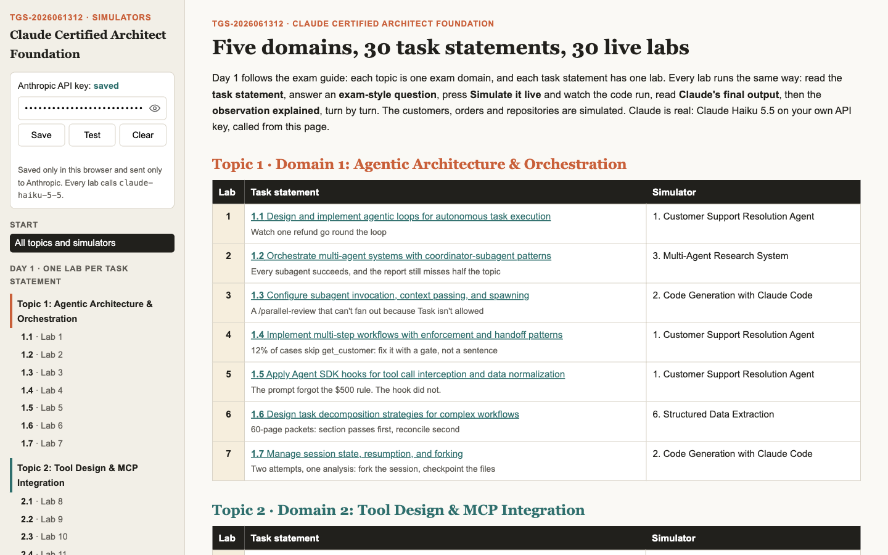
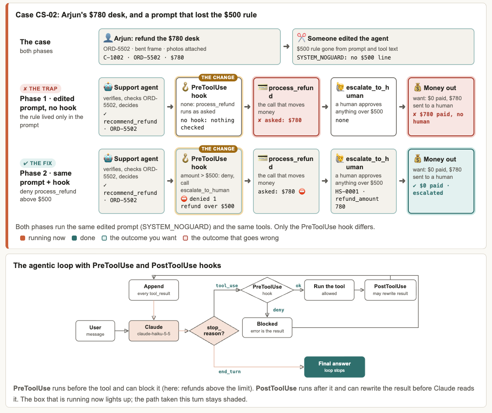

# Claude Certified Architect Foundation

Prepare for Anthropic's CCAR-F exam task statement by task statement: answer each of the 30 as an exam-style question, then watch Claude run the scenario live.

| Course detail | Information |
|---|---|
| Course code | `TGS-2026061312` |
| Programme | WSQ |
| Duration | 2 days / 16 hours (14 hours of training, 2 hours of assessment) |
| Courseware release | Trainer slides v3.7, Lesson Plan v3.5, Learner Guide v3.5 |
| Official exam guide | [Anthropic's CCAR-F Exam Guide v1.0 (PDF, 39 pages)](exam-guide/Claude-Certified-Architect-Foundations-Exam-Guide-v1.0.pdf) |
| Exam-question labs | [Run all 30 labs live in your browser](https://tertiarycourses.github.io/TGS-2026061312-Claude-Certified-Architect-Foundation/) |
| Practice exam | [60 questions, scored by domain](https://exams.tertiaryinfotech.com/practice-exams/anthropic/anthropic-cca-foundations) |
| Registration | [View course details and register](https://www.tertiarycourses.com.sg/wsq-claude-certified-architect-foundation.html) |
| Funding | Up to 70% course fee funding for eligible learners and employers. Eligibility and current terms apply. |

## The exam at a glance

| | |
|---|---|
| Exam code | CCAR-F |
| Questions and time | 60 questions in 120 minutes |
| Format | Multiple-choice and multiple-response questions; each question states how many answers to select |
| Delivery and fee | Proctored, online or at a test centre; $125 USD per attempt |
| Scenarios | Four of the six official scenarios, drawn at random, so prepare all six |
| Domains | Five, weighted 27%, 18%, 20%, 20% and 15% |
| Pass mark | 720 on a scale of 100 to 1,000, against a fixed standard; the score report also shows percent-correct by domain |
| Retakes | Wait 14 days after a first fail, 30 after a second and 90 after a third; at most four attempts in a rolling 12 months, each at the full fee |
| Validity | 12 months; renewing on time is free, through a non-proctored assessment |

These figures are from Anthropic's **[Exam Guide v1.0](exam-guide/Claude-Certified-Architect-Foundations-Exam-Guide-v1.0.pdf)** (effective July 2026), which is in this repository. Read it first: it lists the six scenarios, all 30 task statements with the knowledge and skills behind each, 12 sample questions with explanations, four preparation exercises, and the in-scope and out-of-scope topics. The guide can change without notice, so check Anthropic's current version before you book.

The exam tests judgement more than recall. Most questions describe a system that is failing and offer several fixes that all sound reasonable; the distractors are usually a stronger prompt where the rule belongs in code, or a stricter schema where the meaning needs checking. Many questions sit on the seams between domains. Domain 5 carries only 15% of the score but appears in Scenarios 1, 2, 3 and 6, so at least two of your four scenarios will lean on it.

## How the course prepares you

1. **Day 1: all 30 task statements, as exam questions.** Each lab on the [lab site](https://tertiarycourses.github.io/TGS-2026061312-Claude-Certified-Architect-Foundation/) opens with a four-option question in the exam's style. You commit to an answer, then press **Simulate it live** and watch the scenario run on `claude-haiku-5-5`: the lab's scenario board lights up row by row (the trap first, then the fix), beside a live diagram of the pattern (the agentic loop, the hook gates, a coordinator and its subagents, or separate passes and session forks), the code running, the API request and the outcome. The run pauses after the trap until you press **Proceed**. Nothing to install.
2. **Day 2: build what the questions describe.** In Labs 31 to 35 you paste copy-ready prompts into your AI coding tool and build a customer resolution agent (Scenario 1) and a multi-agent research team (Scenario 3), so the loop, the MCP server and the hooks are things you have run, not terms you have memorised.
3. **Practice exam, then the WSQ assessment.** On the Day 2 afternoon you sit the [practice exam](https://exams.tertiaryinfotech.com/practice-exams/anthropic/anthropic-cca-foundations) in Practice mode and review your score by domain. The course closes with the WSQ assessment: a Written Assessment and a Case Study built on the Day 1 labs.

*Lab 5 after a live run. Someone deleted the $500 refund rule from the prompt: in Phase 1 the agent pays Arjun $780; in Phase 2 a PreToolUse hook denies the same call and Claude escalates to a human instead.*

## Learning outcomes

By the end of the course you will be able to:

- Design bounded agentic loops and multi-agent orchestration with explicit handoffs, state and stop conditions.
- Engineer reliable tool and MCP integrations with precise schemas, structured errors and least-privilege tool distribution.
- Configure Claude Code projects with scoped instructions, reusable skills, rules, plan mode and CI/CD workflows.
- Produce validated structured outputs using clear criteria, few-shot examples, batching and review loops.
- Manage context, uncertainty, provenance and human escalation in large, long-running AI systems.

## Exam domains and where each is covered

| Topic | Exam domain | Exam weight | Task statements | Labs |
|---|---|---:|---|---|
| Topic 1 | Agentic Architecture & Orchestration | 27% | 1.1–1.7 | 1–7 |
| Topic 2 | Tool Design & MCP Integration | 18% | 2.1–2.5 | 8–12 |
| Topic 3 | Claude Code Configuration & Workflows | 20% | 3.1–3.6 | 13–18 |
| Topic 4 | Prompt Engineering & Structured Output | 20% | 4.1–4.6 | 19–24 |
| Topic 5 | Context Management & Reliability | 15% | 5.1–5.6 | 25–30 |
| Bonus Topic A | Build a customer resolution agent with MCP and hooks | | 1.1, 1.4, 1.5, 2.1, 2.2, 2.4 | 31–34 |
| Bonus Topic B | Build a multi-agent research team | | 1.2, 1.3, 5.3 | 35 |

## The six exam scenarios

Each simulator is one official exam scenario. On Day 1 you run all six in the browser on the [lab site](https://tertiarycourses.github.io/TGS-2026061312-Claude-Certified-Architect-Foundation/). The folders below hold the same scenarios as optional local Python versions on the [Claude Agent SDK](https://code.claude.com/docs/en/agent-sdk/overview), run with [uv](https://docs.astral.sh/uv/). The customers and data are fake. Claude is real.

1. **[Customer Support Resolution Agent](labs/simulators/simulator-1-customer-support/)**: Your agent has refund powers. Prove it knows when not to use them.
2. **[Code Generation with Claude Code](labs/simulators/simulator-2-code-generation/)**: Claude Code, configured so the whole team gets the same teammate.
3. **[Multi-Agent Research System](labs/simulators/simulator-3-multi-agent-research/)**: One coordinator, four specialists, zero invented citations.
4. **[Developer Productivity with Claude](labs/simulators/simulator-4-developer-productivity/)**: Find your way around a legacy repo without drowning in it.
5. **[Claude Code for Continuous Integration](labs/simulators/simulator-5-ci-cd/)**: A reviewer in the pipeline that developers don't learn to ignore.
6. **[Structured Data Extraction](labs/simulators/simulator-6-structured-extraction/)**: Messy documents in, trustworthy records out.

### Day 1: nothing to install

Open the **[lab site](https://tertiarycourses.github.io/TGS-2026061312-Claude-Certified-Architect-Foundation/)**, paste your Anthropic API key (it starts with `sk-ant-`) into the sidebar (the eye icon shows or hides it), press **Save**, then **Test**. The key stays in your browser and is sent only to Anthropic. Every lab calls `claude-haiku-5-5`, so a whole lab usually costs under one US cent.

### Day 2: vibe-code on your laptop

You only paste prompts. You need an AI coding tool that can edit files and run commands (Claude Code, Codex, Antigravity, Cursor or similar) and an Anthropic API key.

1. Open your coding tool in a new, empty folder called `orderly-agent`.
2. Open [Lab 31's prompt page](https://tertiarycourses.github.io/TGS-2026061312-Claude-Certified-Architect-Foundation/lab-31.html) and paste the prompts one at a time. Prompt 1 installs uv if you don't have it, downloads the lab's data and creates `.env` with a placeholder.
3. Open `.env` in your editor and replace `paste-your-key-here` with your key. Type it there yourself, never into the chat. Labs 32 to 34 carry on in the same folder.
4. For Lab 35, open the coding tool in a second empty folder, `research-team`, and follow [Lab 35's prompt page](https://tertiarycourses.github.io/TGS-2026061312-Claude-Certified-Architect-Foundation/lab-35.html) the same way.

To run the Day 1 scenarios locally instead, double-click `labs/start-labs.command` (Mac) or `labs\start-labs.cmd` (Windows); see [labs/START-LABS.md](labs/START-LABS.md).

## Labs

Every lab has its own folder with a step-by-step `README.md` and `README.pdf`.

### Day 1: one exam-style question and one live simulation per task statement

**Topic 1: Agentic Architecture & Orchestration (27% of the exam)**

| Lab | Task statement | Scenario | What the question turns on |
|---|---|---|---|
| 1 | 1.1 | 1 | [Watch one refund go round the loop](https://tertiarycourses.github.io/TGS-2026061312-Claude-Certified-Architect-Foundation/lab.html?n=1) ([guide](labs/lab-01-watch-one-refund-go-round-the-loop/)) |
| 2 | 1.2 | 3 | [Every subagent succeeds, and the report still misses half the topic](https://tertiarycourses.github.io/TGS-2026061312-Claude-Certified-Architect-Foundation/lab.html?n=2) ([guide](labs/lab-02-every-subagent-succeeds-and-the-report/)) |
| 3 | 1.3 | 2 | [A /parallel-review that can't fan out because Task isn't allowed](https://tertiarycourses.github.io/TGS-2026061312-Claude-Certified-Architect-Foundation/lab.html?n=3) ([guide](labs/lab-03-a-parallel-review-that-can-t-fan-out/)) |
| 4 | 1.4 | 1 | [12% of cases skip get_customer: fix it with a gate, not a sentence](https://tertiarycourses.github.io/TGS-2026061312-Claude-Certified-Architect-Foundation/lab.html?n=4) ([guide](labs/lab-04-12-of-cases-skip-get-customer-fix-it/)) |
| 5 | 1.5 | 1 | [The prompt forgot the $500 rule. The hook did not.](https://tertiarycourses.github.io/TGS-2026061312-Claude-Certified-Architect-Foundation/lab.html?n=5) ([guide](labs/lab-05-the-prompt-forgot-the-500-rule-the-hook/)) |
| 6 | 1.6 | 6 | [60-page packets: section passes first, reconcile second](https://tertiarycourses.github.io/TGS-2026061312-Claude-Certified-Architect-Foundation/lab.html?n=6) ([guide](labs/lab-06-60-page-packets-section-passes-first/)) |
| 7 | 1.7 | 2 | [Two attempts, one analysis: fork the session, checkpoint the files](https://tertiarycourses.github.io/TGS-2026061312-Claude-Certified-Architect-Foundation/lab.html?n=7) ([guide](labs/lab-07-two-attempts-one-analysis-fork-the/)) |

**Topic 2: Tool Design & MCP Integration (18% of the exam)**

| Lab | Task statement | Scenario | What the question turns on |
|---|---|---|---|
| 8 | 2.1 | 6 | [One analyze_document tool does three jobs badly](https://tertiarycourses.github.io/TGS-2026061312-Claude-Certified-Architect-Foundation/lab.html?n=8) ([guide](labs/lab-08-one-analyze-document-tool-does-three/)) |
| 9 | 2.2 | 1 | [The refund failed. The customer was told it worked.](https://tertiarycourses.github.io/TGS-2026061312-Claude-Certified-Architect-Foundation/lab.html?n=9) ([guide](labs/lab-09-the-refund-failed-the-customer-was-told/)) |
| 10 | 2.3 | 5 | [Review and test generation fight over one Claude call](https://tertiarycourses.github.io/TGS-2026061312-Claude-Certified-Architect-Foundation/lab.html?n=10) ([guide](labs/lab-10-review-and-test-generation-fight-over/)) |
| 11 | 2.4 | 2 | [Commit the server, never the token](https://tertiarycourses.github.io/TGS-2026061312-Claude-Certified-Architect-Foundation/lab.html?n=11) ([guide](labs/lab-11-commit-the-server-never-the-token/)) |
| 12 | 2.5 | 4 | [/find-callers needs Grep with a glob, not Bash](https://tertiarycourses.github.io/TGS-2026061312-Claude-Certified-Architect-Foundation/lab.html?n=12) ([guide](labs/lab-12-find-callers-needs-grep-with-a-glob-not/)) |

**Topic 3: Claude Code Configuration & Workflows (20% of the exam)**

| Lab | Task statement | Scenario | What the question turns on |
|---|---|---|---|
| 13 | 3.1 | 2 | [Which instructions actually reached Claude?](https://tertiarycourses.github.io/TGS-2026061312-Claude-Certified-Architect-Foundation/lab.html?n=13) ([guide](labs/lab-13-which-instructions-actually-reached/)) |
| 14 | 3.2 | 1 | [Keep a noisy case review out of your main session](https://tertiarycourses.github.io/TGS-2026061312-Claude-Certified-Architect-Foundation/lab.html?n=14) ([guide](labs/lab-14-keep-a-noisy-case-review-out-of-your/)) |
| 15 | 3.3 | 3 | [Testing rules for test files spread across every folder](https://tertiarycourses.github.io/TGS-2026061312-Claude-Certified-Architect-Foundation/lab.html?n=15) ([guide](labs/lab-15-testing-rules-for-test-files-spread/)) |
| 16 | 3.4 | 2 | [Replacing the auth layer: nobody agrees on the boundary, so plan](https://tertiarycourses.github.io/TGS-2026061312-Claude-Certified-Architect-Foundation/lab.html?n=16) ([guide](labs/lab-16-replacing-the-auth-layer-nobody-agrees/)) |
| 17 | 3.5 | 3 | [Two linked defects go in one detailed request](https://tertiarycourses.github.io/TGS-2026061312-Claude-Certified-Architect-Foundation/lab.html?n=17) ([guide](labs/lab-17-two-linked-defects-go-in-one-detailed/)) |
| 18 | 3.6 | 5 | [The nightly job hangs because nobody can press Enter](https://tertiarycourses.github.io/TGS-2026061312-Claude-Certified-Architect-Foundation/lab.html?n=18) ([guide](labs/lab-18-the-nightly-job-hangs-because-nobody-can/)) |

**Topic 4: Prompt Engineering & Structured Output (20% of the exam)**

| Lab | Task statement | Scenario | What the question turns on |
|---|---|---|---|
| 19 | 4.1 | 5 | ["Only high confidence" didn't quiet the reviewer](https://tertiarycourses.github.io/TGS-2026061312-Claude-Certified-Architect-Foundation/lab.html?n=19) ([guide](labs/lab-19-only-high-confidence-didn-t-quiet-the/)) |
| 20 | 4.2 | 2 | ["Clean this up" means three things: show which one you mean](https://tertiarycourses.github.io/TGS-2026061312-Claude-Certified-Architect-Foundation/lab.html?n=20) ([guide](labs/lab-20-clean-this-up-means-three-things-show/)) |
| 21 | 4.3 | 6 | [Know your tool_choice options, and check what came back](https://tertiarycourses.github.io/TGS-2026061312-Claude-Certified-Architect-Foundation/lab.html?n=21) ([guide](labs/lab-21-know-your-tool-choice-options-and-check/)) |
| 22 | 4.4 | 6 | [Retry when the format is wrong, stop when the data is absent](https://tertiarycourses.github.io/TGS-2026061312-Claude-Certified-Architect-Foundation/lab.html?n=22) ([guide](labs/lab-22-retry-when-the-format-is-wrong-stop-when/)) |
| 23 | 4.5 | 1 | [Prove the template before 35,000 transcripts](https://tertiarycourses.github.io/TGS-2026061312-Claude-Certified-Architect-Foundation/lab.html?n=23) ([guide](labs/lab-23-prove-the-template-before-35-000/)) |
| 24 | 4.6 | 5 | [14 files, shallow comments: split the review](https://tertiarycourses.github.io/TGS-2026061312-Claude-Certified-Architect-Foundation/lab.html?n=24) ([guide](labs/lab-24-14-files-shallow-comments-split-the/)) |

**Topic 5: Context Management & Reliability (15% of the exam)**

| Lab | Task statement | Scenario | What the question turns on |
|---|---|---|---|
| 25 | 5.1 | 1 | [Refund amount jumped to the wrong order](https://tertiarycourses.github.io/TGS-2026061312-Claude-Certified-Architect-Foundation/lab.html?n=25) ([guide](labs/lab-25-refund-amount-jumped-to-the-wrong-order/)) |
| 26 | 5.2 | 1 | [55% first-contact resolution: calibrate with criteria and examples](https://tertiarycourses.github.io/TGS-2026061312-Claude-Certified-Architect-Foundation/lab.html?n=26) ([guide](labs/lab-26-55-first-contact-resolution-calibrate/)) |
| 27 | 5.3 | 3 | [The search timed out: tell the coordinator everything](https://tertiarycourses.github.io/TGS-2026061312-Claude-Certified-Architect-Foundation/lab.html?n=27) ([guide](labs/lab-27-the-search-timed-out-tell-the/)) |
| 28 | 5.4 | 4 | [Delegate the noisy search, keep a scratchpad](https://tertiarycourses.github.io/TGS-2026061312-Claude-Certified-Architect-Foundation/lab.html?n=28) ([guide](labs/lab-28-delegate-the-noisy-search-keep-a/)) |
| 29 | 5.5 | 6 | [The aggregate masks a segment: break it and watch](https://tertiarycourses.github.io/TGS-2026061312-Claude-Certified-Architect-Foundation/lab.html?n=29) ([guide](labs/lab-29-the-aggregate-masks-a-segment-break-it/)) |
| 30 | 5.6 | 3 | [A vendor benchmark isn't a peer-reviewed study](https://tertiarycourses.github.io/TGS-2026061312-Claude-Certified-Architect-Foundation/lab.html?n=30) ([guide](labs/lab-30-a-vendor-benchmark-isn-t-a-peer-reviewed/)) |

### Day 2 · Bonus Topic A: build a customer resolution agent with MCP and hooks

You paste prompts, read the code your AI coding tool writes, and run it. Each lab has a prompt page with a Copy button on every prompt, a `solution/` folder and a real run in `sample-output.txt`.

| Lab | Task statements | What you build |
|---|---|---|
| 31 | 1.1, 2.1 | [Vibe-code the customer resolution agent with the Python SDK](https://tertiarycourses.github.io/TGS-2026061312-Claude-Certified-Architect-Foundation/lab-31.html) ([folder](labs/lab-31-build-the-customer-resolution-agent/)) |
| 32 | 2.4, 2.2 | [Vibe-code an MCP server for the agent's tools](https://tertiarycourses.github.io/TGS-2026061312-Claude-Certified-Architect-Foundation/lab-32.html) ([folder](labs/lab-32-move-the-tools-to-an-mcp-server/)) |
| 33 | 1.5, 1.4 | [Vibe-code a PreToolUse hook that blocks the $780 refund](https://tertiarycourses.github.io/TGS-2026061312-Claude-Certified-Architect-Foundation/lab-33.html) ([folder](labs/lab-33-pretooluse-hook-blocks-the-780-refund/)) |
| 34 | 1.5 | [Vibe-code a PostToolUse hook that cleans the data, then prove the agent works](https://tertiarycourses.github.io/TGS-2026061312-Claude-Certified-Architect-Foundation/lab-34.html) ([folder](labs/lab-34-posttooluse-hook-cleans-the-data/)) |

### Day 2 · Bonus Topic B: build a multi-agent research team

| Lab | Task statements | What you build |
|---|---|---|
| 35 | 1.2, 1.3, 5.3 | [Vibe-code a multi-agent research team](https://tertiarycourses.github.io/TGS-2026061312-Claude-Certified-Architect-Foundation/lab-35.html) ([folder](labs/lab-35-build-a-multi-agent-research-team/)) |

### Bonus practice exam

Sit the [practice exam](https://exams.tertiaryinfotech.com/practice-exams/anthropic/anthropic-cca-foundations) in Practice mode on the Day 2 afternoon, review your score by domain, and go back to the labs for your weakest domain. Sit it again under timed conditions (60 questions, 120 minutes) before you book the real exam.

### Extra: hand-written code builds (optional, not taught in class)

Optional builds in curl, the Python SDK and Claude Code, for task statements you want more practice on. Save your key once in `labs/` with `uv run set_api_key.py`; Labs 41 and 42 also need Claude Code.

| Lab | Task statements | What you build |
|---|---|---|
| 36 | 1.1 | [From one API call to a working agent loop](labs/lab-36-first-api-call-to-agent-loop/) |
| 37 | 1.5 | [Build the hooks that the prompt can't be trusted with](labs/lab-37-build-agent-hooks/) |
| 38 | 1.2, 1.3 | [Be the coordinator: brief your subagents or they work blind](labs/lab-38-coordinator-and-subagents/) |
| 39 | 2.1, 2.3 | [Write the tool description Claude actually reads](labs/lab-39-tool-design-and-tool-choice/) |
| 40 | 2.4 | [Build an MCP server once, plug it into any agent](labs/lab-40-build-an-mcp-server/) |
| 41 | 3.2, 3.3 | [Teach Claude Code your repo: a /review skill and a rule that loads only for tests](labs/lab-41-skills-and-path-rules/) |
| 42 | 3.6 | [Put Claude Code in the pipeline and let the exit code decide](labs/lab-42-claude-code-in-ci/) |
| 43 | 4.3 | [Valid JSON is the floor: check the meaning yourself](labs/lab-43-structured-output/) |
| 44 | 4.5 | [Half price, no hurry: triage tickets with the Batches API](labs/lab-44-message-batches/) |
| 45 | 5.1 | [Keep the facts, cache the handbook](labs/lab-45-context-and-prompt-caching/) |
| 46 | 5.3 | [When a subagent fails, tell the coordinator everything](labs/lab-46-error-propagation/) |

## In this repository

- [Anthropic's CCAR-F Exam Guide v1.0, PDF](exam-guide/Claude-Certified-Architect-Foundations-Exam-Guide-v1.0.pdf)
- [Trainer slides, PowerPoint](courseware/TGS-2026061312-Claude-Certified-Architect-Foundation-Trainer-Slides-v3.7.pptx) and [PDF](courseware/TGS-2026061312-Claude-Certified-Architect-Foundation-Trainer-Slides-v3.7.pdf)
- [Lesson Plan, Word](courseware/LP-Claude-Certified-Architect-Foundation-v3.5.docx) and [PDF](courseware/LP-Claude-Certified-Architect-Foundation-v3.5.pdf)
- [Learner Guide, Word](courseware/LG-Claude-Certified-Architect-Foundation-v3.5.docx), [PDF](courseware/LG-Claude-Certified-Architect-Foundation-v3.5.pdf) and [Markdown](courseware/LG-Claude-Certified-Architect-Foundation-v3.5.md)
- [The labs folder](labs/): 46 lab folders (30 Day 1, 5 Day 2, 11 optional code builds) and the six Python simulators
- [`docs/`](docs/): the source of the [lab site](https://tertiarycourses.github.io/TGS-2026061312-Claude-Certified-Architect-Foundation/) (GitHub Pages)

Your API key stays on your machine: the lab site keeps it in your browser only, and the Day 2 labs read it from a `.env` file that is never committed.

## What isn't here

Assessment papers, answer keys, the Facilitator Guide, the Assessment Plan, source references and credentials stay private. Trainers and learners get them through the LMS.

## Acknowledgements

The original lab scenarios were informed by publicly available study projects from [Paul Larionov](https://github.com/paullarionov/claude-certified-architect), [Ade Regil](https://github.com/aderegil/claude-certified-architect) and [Daron Yondem](https://github.com/daronyondem/claude-architect-exam-guide). No assessment or solution content from those repositories is redistributed here.

Lab questions come from the exam guide's task statements and official samples, and from SkillCertPro's Part 1 practice exam (third-party and unofficial). They are written for practice and are not real exam items.

## Provider

Provided by [Tertiary Infotech Academy Pte Ltd](https://www.tertiarycourses.com.sg/) (UEN 201200696W).

This is independent exam-preparation courseware. Claude and the Claude Certified Architect exam are Anthropic's.
